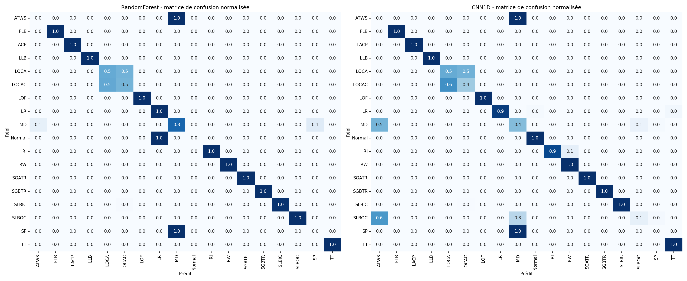
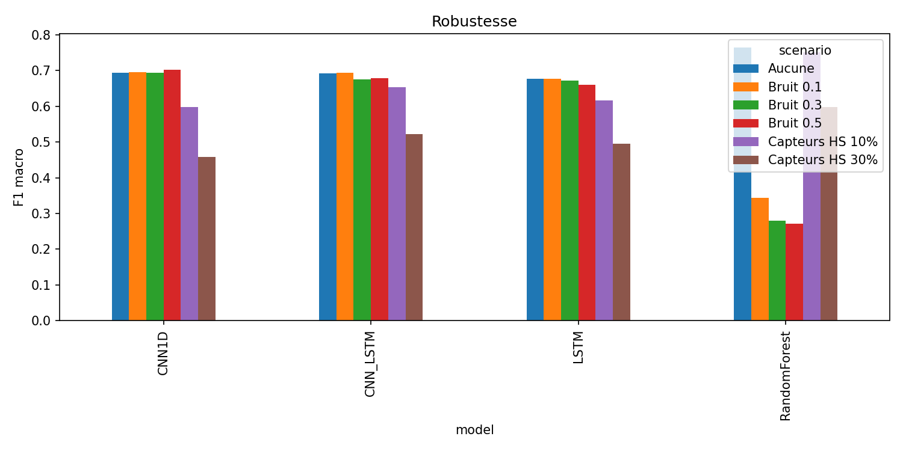
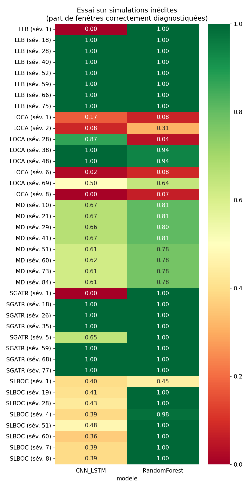
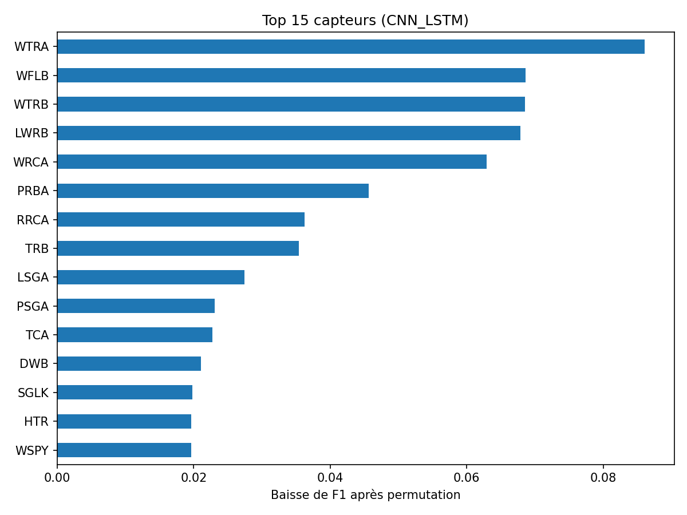

# Diagnostic d'accidents de centrale nucléaire par apprentissage automatique

[](https://colab.research.google.com/github/Developer-Dynamo/nppad-accident-diagnosis/blob/main/nppad_accident_diagnosis.ipynb)

## Description

Le projet est consacré au développement d'un système de diagnostic automatique d'accidents dans un réacteur à eau pressurisée (REP/PWR). À partir de l'évolution de 89 capteurs (pression, température, débits, niveaux...), le modèle identifie la situation en cours parmi 18 conditions d'exploitation : fonctionnement normal et 17 types d'accidents. Une telle solution peut aider les opérateurs à réagir plus vite en salle de contrôle.

Les données proviennent du dataset ouvert **NPPAD**, généré avec le simulateur PCTRAN.

## Objectif de l'étude

Comparer une méthode classique (Random Forest) à trois architectures de deep learning (CNN 1D, LSTM, CNN-LSTM) pour le diagnostic d'accidents, et évaluer leur qualité avec le **F1 macro** et l'**accuracy**, ainsi que leur robustesse au bruit, aux capteurs en panne et à des simulations jamais vues.

## Déroulement de l'étude

- Préparation des données et analyse du dataset :
  - 486 simulations chargées (40 maximum par classe), 580 pas de temps de 10 s chacune
  - suppression de 7 capteurs constants (89 capteurs conservés)
- Découpage et préparation :
  - découpage 70 / 15 / 15 par simulation entière, pour éviter les fuites de données
  - fenêtres glissantes de 30 pas (stride 10), soit 12 815 fenêtres d'entraînement
  - normalisation calculée sur le train uniquement
  - perte pondérée par classe pour compenser le déséquilibre
- Modélisation :
  - baseline : Random Forest sur caractéristiques statistiques (moyenne, écart-type, min, max, variation)
  - entraînement de trois réseaux : CNN 1D, LSTM, CNN-LSTM (PyTorch, GPU)
  - évaluation sur le jeu de test
- Tests de robustesse :
  - bruit gaussien (σ de 0,1 à 0,5)
  - capteurs hors service (10 % et 30 %)
  - importance des capteurs par permutation
- Essai pratique sur 40 simulations inédites (8 par accident, 5 accidents)
- Conclusions et recommandations.

## Technologies

Python, PyTorch, scikit-learn, Pandas, NumPy, Matplotlib, Seaborn, Google Colab (GPU T4), séries temporelles, CNN, LSTM, Random Forest.

## Résultats clés

### Comparaison des modèles (jeu de test)

| Modèle | Accuracy | F1 macro (18 classes) | F1 macro (12 classes à support ≥ 50) |
|---|---|---|---|
| **Random Forest** | **0,885** | **0,769** | **0,905** |
| CNN 1D | 0,737 | 0,693 | 0,785 |
| LSTM | 0,745 | 0,677 | 0,787 |
| CNN-LSTM | 0,781 | 0,692 | 0,811 |

Six classes n'ont qu'une seule simulation (ATWS, LACP, LOF, Normal, SP, TT) et moins de 10 fenêtres de test : leur F1 est peu fiable, c'est pourquoi un second F1, limité aux 12 classes à support suffisant, est donné.



### Robustesse (F1 macro)

| Perturbation | Random Forest | CNN 1D | LSTM | CNN-LSTM |
|---|---|---|---|---|
| Aucune | **0,769** | 0,693 | 0,677 | 0,692 |
| Bruit σ = 0,1 | 0,343 | **0,695** | 0,677 | 0,693 |
| Bruit σ = 0,3 | 0,279 | **0,694** | 0,672 | 0,675 |
| Bruit σ = 0,5 | 0,272 | **0,702** | 0,661 | 0,679 |
| 10 % de capteurs hors service | **0,751** | 0,598 | 0,616 | 0,654 |
| 30 % de capteurs hors service | **0,598** | 0,459 | 0,496 | 0,522 |



### Essai sur simulations inédites

Part des fenêtres correctement diagnostiquées sur 8 simulations jamais utilisées, par accident :

| Accident | CNN-LSTM | Random Forest |
|---|---|---|
| LLB | 0,88 | 1,00 |
| SGATR | 0,83 | 1,00 |
| MD | 0,64 | 0,79 |
| SLBOC | 0,41 | 0,93 |
| LOCA | 0,46 | 0,39 |



### Capteurs les plus influents (CNN-LSTM)

`WTRA`, `WFLB`, `WTRB`, `LWRB`, `WRCA`.



### Conclusions

- Sur données propres, le **Random Forest est le meilleur modèle** (F1 macro 0,769), devant les trois réseaux (0,68 à 0,69).
- Face au **bruit**, les réseaux restent stables alors que le Random Forest s'effondre (0,27).
- Avec des **capteurs en panne**, le Random Forest reste meilleur ; CNN-LSTM est le plus résistant des réseaux.
- Le Random Forest reconnaît presque parfaitement 12 classes sur 18 (rappel proche de 1,0). Les difficultés viennent de **LOCA / LOCAC** (confondues à environ 50 %) et de **MD** ; les réseaux échouent en plus sur **SLBOC**.
- Les accidents de **très faible sévérité** sont les plus difficiles : à la sévérité 1, CNN-LSTM échoue sur LLB et SGATR (0,00) alors qu'il réussit dès la sévérité 18.
- Aucun modèle ne gagne partout : le choix dépend du risque que l'on redoute le plus (bruit de mesure ou capteurs défaillants).

## Reproduire

1. Cliquer sur le badge **Open in Colab** en haut de la page.
2. Activer un GPU : *Exécution → Modifier le type d'exécution → GPU T4*.
3. Exécuter les cellules dans l'ordre (le dataset est téléchargé automatiquement, environ 15 à 25 minutes au total).

## Structure du dépôt

```
nppad-accident-diagnosis/
├── nppad_accident_diagnosis.ipynb   # notebook complet
├── requirements.txt
├── README.md
├── LICENSE
└── results/                         # tableaux (CSV) et graphiques (PNG)
```

## Source des données

Qi, B., Xiao, X., Liang, J., Po, L., Tong, J. *An open time-series simulated dataset covering various accidents for nuclear power plants.* Scientific Data 9, 766 (2022).
Dataset : https://github.com/thu-inet/NuclearPowerPlantAccidentData (licence MIT).
